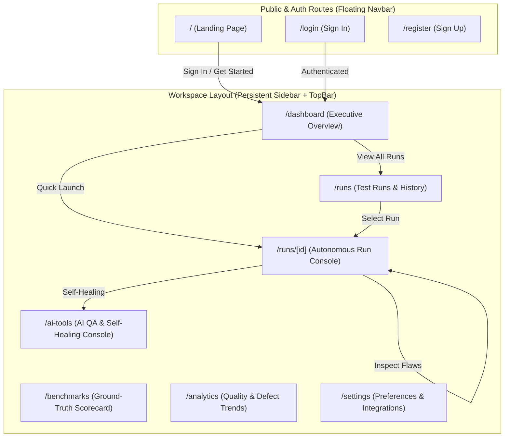

# DRISHTI AI — Comprehensive Enterprise QA Platform Revamp Plan

> **Role**: Senior Product Designer, UX Architect, and Frontend Engineering Lead  
> **Date**: October 24, 2026  
> **Target Architecture**: Next.js 16 (App Router), Tailwind CSS v4, Lucide Icons, ShadCN/UI, Simulithic Design System  
> **Backend Constraint**: **STRICTLY FRONTEND ONLY**. Zero modifications to backend route handlers, API contracts, data schemas, or autonomous runner execution logic.

---

## Executive Summary

DRISHTI AI is an autonomous AI QA engineering platform that crawls web applications, maps accessible DOM trees, plans invariant test suites, executes 3× isolated browser replay cycles to verify defects with 0.0% flakiness, and generates standalone Python Playwright test artifacts.

While individual screens (such as the redesigned landing page and the run report) have strong visual elements, the application previously felt like a **disconnected collection of pages**:
1. Starting an audit required scrolling to an embedded section on the marketing landing page.
2. Visiting `/runs` resulted in a 404 (only `/runs/[id]` existed).
3. The floating pill navbar (`Navbar.js`) hovered over internal workspace screens, physically obstructing critical audit headlines and controls (as identified in user feedback and screenshot `media_1792849843947_085dc39c.png`).
4. Users had no central workspace to monitor testing velocity, active test suites, defect trends, or initiate quick audits.

This plan details the transformation of DRISHTI AI into a cohesive, production-grade QA workspace modeled after industry benchmarks (**Qase, Testmo, TestRail, BrowserStack, and QA Wolf**), featuring a persistent sidebar layout, a centralized executive Dashboard, dedicated workflow pages, and unified persona-tailored experiences.

---

## 1. Current UI/UX Audit & Usability Problems

| Usability Issue | Description & Impact | Solution in Revamp |
| :--- | :--- | :--- |
| **Navbar Overlap Collision** | Floating capsule navbar (`fixed top-6 sm:top-8 z-50`) overlaps the top 120px of workspace pages, obscuring the Executive Verdict title. | Isolate floating navbar to public marketing routes (`/`, `/login`, `/register`). Workspace routes use a persistent sidebar and top breadcrumb header. |
| **Missing Primary Workspace (Dashboard)** | Users had no hub to see recent runs, active audits, health metrics, or defect distribution. | Create `/dashboard` with key metrics (Total Runs, Pass Rate, Defect Density, Flakiness), Quick Launch modal, and Recent Activity table. |
| **Dead-End Navigation (`/runs` 404)** | Navigating to `/runs` 404'd because only dynamic route `/runs/[id]` was defined. | Create `/runs/page.js` with searchable, filterable test run repository, status pills, and quick re-run triggers. |
| **Scattered AI Tools** | Natural Language Testing and Self-Healing were buried in sub-tabs of individual historical runs. | Create dedicated `/ai-tools` workspace allowing live prompt execution and locator drift recovery on any connected target. |
| **Disconnected Benchmarks** | `/benchmarks` was an isolated page with generic navigation buttons. | Integrate Ground-Truth Benchmarks into the workspace sidebar under *Quality & Benchmarks*. |
| **No User Settings / Persona Storage** | Persona state was stored in `localStorage` without a dedicated configuration surface. | Create `/settings` page with Persona selection, API endpoint health, and Playwright execution presets. |

---

## 2. Competitor Research & Transferable Design Patterns

### Benchmarking Table

| Capability | Qase / Testmo | BrowserStack / QA Wolf | DRISHTI AI Implementation |
| :--- | :--- | :--- | :--- |
| **Information Architecture** | Persistent multi-tier left sidebar with project context. | Real-time session drawer with live screencasts. | **Persistent collapsible sidebar** with clear section groupings (*Overview, Testing, Intelligence, Governance*). |
| **Test Run Hub** | Central test runs table with pass/fail donut, duration, and branch tags. | Live agent terminal with sequential step execution. | **Runs Management Hub (`/runs`)** with live status indicators, target host badge, defect counter, and quick rerun. |
| **Visual Evidence** | Attached failure screenshots in a modal. | Side-by-side DOM diff with video replay. | **Side-by-side screenshots with red anomaly bounding box** and instant lightbox expansion. |
| **CI/CD Export** | Webhook integration guides. | Hosted cloud runner scripts. | **1-Click Artifact Hub**: Standalone Pytest `.py`, GitHub Actions `.yml`, and Docker container. |
| **Persona Switching** | Separate role permissions. | Dev-first terminal view. | **Instant 3-Role Viewport (`PM`, `Dev`, `QA`)** adapting typography, summaries, and technical depth on the fly. |

---

## 3. Proposed Information Architecture & Workspace Structure



### Sidebar Navigation Structure

```
DRISHTI AI (Workspace: Production & Staging)
├── OVERVIEW
│   └── 📊 Dashboard (/dashboard)
├── TESTING WORKFLOWS
│   ├── ⚡ Test Runs (/runs)
│   └── 🚀 New Test Run (Modal Quick Launch)
├── INTELLIGENCE & ACCURACY
│   ├── 🧠 AI Agent & Self-Healing (/ai-tools)
│   ├── 🏆 Ground-Truth Benchmarks (/benchmarks)
│   └── 📈 Analytics & Quality Trends (/analytics)
└── SYSTEM & CONFIG
    └── ⚙️ Settings & Personas (/settings)

[BOTTOM DOCK]
├── 👔/🛠️/🧪 Persona Switcher (PM / Dev / QA)
└── 👤 Paras (Lead QA Engineer) • Sign Out
```

---

## 4. Dashboard Experience & Layout Specifications (`/dashboard`)

The redesigned `/dashboard` is the command center answering the 5 critical user questions:

1. **What is happening in my workspace?**
   - Live Swarm Status: Active agent count, headless browser sandboxes running, API health.
2. **What needs my attention?**
   - Active Release Blockers Banner: Highlighting any blocker defects currently preventing production release.
3. **What have I worked on recently?**
   - Recent Audited Targets: Cards showing `www.mywealthwise.in`, `padmorasarees.com`, and `shoplite.dev` with pass rates and last run times.
4. **What are my current results and progress?**
   - 4 High-Level Metrics:
     - **Overall Quality Score**: Average percentage across all verified runs (e.g., `92%`).
     - **Flakiness Verification**: `0.0%` (3× fresh context replay guarantee).
     - **Active Blockers**: Count of unresolved critical/high flaws.
     - **Automated Tests Generated**: Count of compiled Playwright assertions.
5. **What should I do next?**
   - Prominent **Quick Launch Audit CTA** ("+ Launch Autonomous Audit") opening a modal to test any target URL or select preset targets.

---

## 5. Page-by-Page Redesign Specifications

### 5.1 Workspace Layout Wrapper (`apps/frontend/app/(workspace)/layout.js` or conditional workspace shell)
- **Persistent Sidebar**: Width 256px (`w-64`), hairline border `#e6e9ee`, background `#ffffff`, responsive collapse on mobile (`< 1024px`) with hamburger trigger.
- **Top Bar**: Breadcrumb path, active persona indicator, "Quick Audit" button, help documentation link.
- **Content Viewport**: Pure white/neutral canvas with generous padding, zero navbar overlap.

### 5.2 Test Runs Hub (`/runs`)
- **Header**: Search bar by hostname/target URL, status filter (`All`, `Completed`, `Active`), and sorting.
- **Run Cards / Table**:
  - Target URL with protocol badge (`HTTPS TLS 1.3`).
  - Run Status Pill (`Completed`, `Executing`, `Preflight`).
  - Executive Verdict (`Ready to Ship`, `Needs Review`, `Release Blocked`).
  - Metric Summary: Pass rate, defect count, discovered routes.
  - Action menu: View Full Report, Re-run Suite, Download Pytest Script.

### 5.3 Dedicated AI Tools Workspace (`/ai-tools`)
- Dedicated full-page experience for:
  - **Natural Language Test Execution**: Input prompt &rarr; Playwright assertion compiler &rarr; Real-time execution telemetry.
  - **Self-Healing Locator Drift Playground**: Interactive selector breakage simulation (Legacy ID, Tailwind class shift, CSS-in-JS hash change, XPath collapse) with instant recovery diff.

### 5.4 Analytics & Quality Trends (`/analytics`)
- Visual breakdown of defect types across audits (Security Invariants, Server Errors, Navigation 404s, Client Input Contracts).
- Journey pass-rate trends.
- Flakiness analysis proving 0.0% transient failures.

### 5.5 Settings & Preferences (`/settings`)
- Active persona default configuration (`PM`, `Dev`, `QA`).
- Browser execution mode (Headless Chromium, Concurrency limit: 3).
- Test suite defaults (pytest-playwright).
- System environment telemetry (Node.js runtime, API endpoint connectivity).

---

## 6. Design System & Component Guidelines (Simulithic)

- **Color Palette**:
  - Primary Background: `#ffffff`
  - Secondary / Card Background: `#ffffff` / `#fafafa`
  - Hairline Border: `#e6e9ee`
  - Primary Accent: Electric Sky Blue `#2D9FFE` (Hover `#0b7ee6`)
  - Typography: Pure Black `#000000`, Charcoal `#262626`, Muted `#737373`
  - Status Indicators: Emerald (`#10b981`), Rose (`#f43f5e`), Amber (`#f59e0b`)
- **Elevation**:
  - Cards: Hairline border `border-[#e6e9ee]` + subtle shadow `shadow-[0_1px_3px_rgba(0,0,0,0.02)]`.
  - Active Pills: Inset or subtle accent fill `bg-[#2D9FFE]/10 text-[#0b7ee6] border-[#2D9FFE]/30`.
- **Navigation Components**:
  - `WorkspaceSidebar.js`: Collapsible, active route indicator, persona switcher.
  - `WorkspaceHeader.js`: Breadcrumbs, quick actions, user profile.
  - `QuickLaunchModal.js`: Reusable modal to launch autonomous runs from any page.

---

## 7. Existing Functionality Preserved (Zero Backend Changes)

1. **API Endpoints Retained**:
   - `POST /api/runs` &rarr; Starts autonomous multi-agent audit.
   - `GET /api/runs` &rarr; Returns all runs from memory store.
   - `GET /api/runs/[id]` &rarr; Fetches run metadata.
   - `GET /api/runs/[id]/events` &rarr; Telemetry event stream.
   - `GET /api/findings?run_id=[id]` &rarr; Findings/defects data.
   - `GET /api/runs/[id]/model` &rarr; Discovered routes & DOM locators.
   - `GET /api/runs/[id]/tests` &rarr; Generated Python Playwright code.
   - `GET /api/runs/[id]/memory` &rarr; Self-healing chains.
   - `POST /api/runs/[id]/step` &rarr; Natural language step compilation.
   - `POST /api/runs/[id]/heal` &rarr; Locator drift repair.
   - `GET /api/screenshot` & `/api/proxy-preview` &rarr; Visual evidence.
2. **Preset Targets Supported**:
   - WealthWise Personal Finance (`https://www.mywealthwise.in`)
   - Padmora Sarees E-Commerce (`https://padmorasarees.com`)
   - ShopLite Ground-Truth Seeded Target (`http://localhost:3001`)

---

## 8. Phased Implementation Roadmap

### Phase 1: Workspace Shell & Sidebar Architecture
- [ ] Create `WorkspaceLayout` component with collapsible sidebar and top header.
- [ ] Update `Navbar.js` to only render on public marketing routes (`/`, `/login`, `/register`).
- [ ] Create `QuickLaunchModal.js` reusable component for instant run creation from anywhere.

### Phase 2: Executive Dashboard (`/dashboard`)
- [ ] Build `/dashboard/page.js` with workspace health summary, blocker alerts, recent targets, and runs table.
- [ ] Connect dashboard metrics directly to `GET /api/runs`.

### Phase 3: Test Runs Repository (`/runs`)
- [ ] Build `/runs/page.js` listing all past and active runs with search, status filters, and instant navigation to `/runs/[id]`.

### Phase 4: Dedicated Intelligence & Governance Pages
- [ ] Build `/ai-tools/page.js` bringing prompt testing and locator drift healing into a dedicated tool view.
- [ ] Build `/analytics/page.js` showing defect distribution and test velocity metrics.
- [ ] Build `/settings/page.js` for persona management and execution settings.
- [ ] Align `/benchmarks/page.js` inside the workspace layout.

### Phase 5: Verification & Quality Assurance
- [ ] Verify zero overlapping elements on all screens.
- [ ] Run `npm run lint` and verify 0 errors.
- [ ] Verify hot compilation on Next.js dev server.
