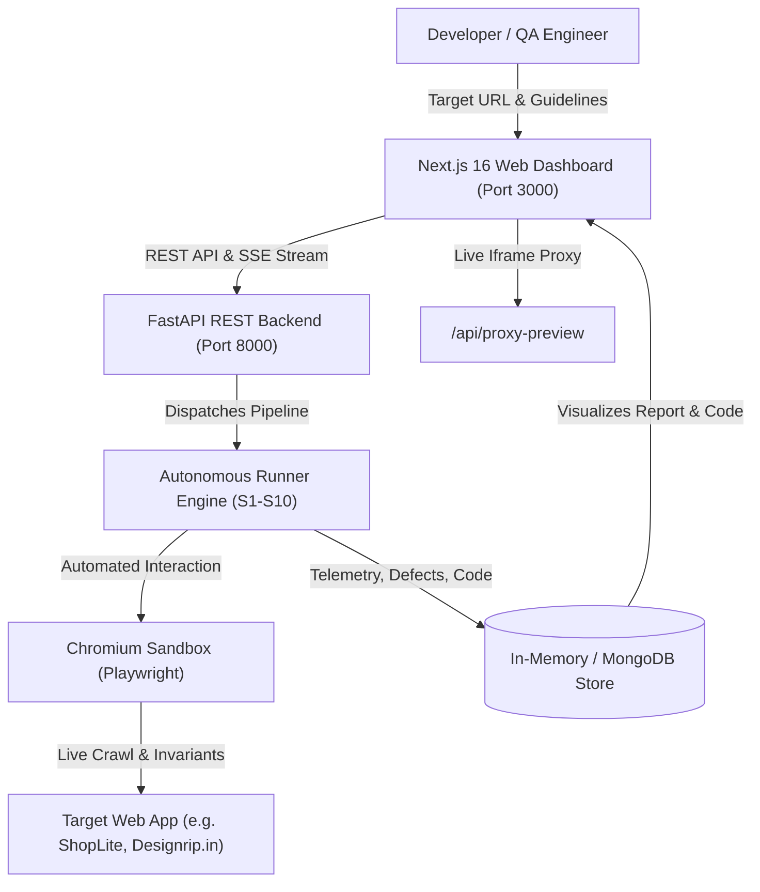

# DRISHTI AI — Project Context & Complete Application Guide

> **Project Name:** DRISHTI AI — Autonomous AI QA Engineer  
> **Event / Track:** CODE APEX 3.0 | iMocha Track (IM-02)  
> **Team:** Refactor  
> **Repository:** [https://github.com/TechWithAkash/agent-qa.git](https://github.com/TechWithAkash/agent-qa.git)

---

## 1. Executive Summary & Purpose

**DRISHTI AI** is an autonomous AI QA engineering platform designed to test real-world web applications the way an experienced human QA engineer would. 

Instead of requiring developers to manually write fragile test scripts, DRISHTI AI accepts a target URL and optional test guidelines, launches an autonomous multi-agent pipeline, discovers pages and DOM elements, plans realistic user journeys (including sign-up, login, and edge cases), executes them in real browser sandboxes via Playwright, validates failures with strict machine-checkable invariants, and generates an executive audit report along with self-healing, repeatable `pytest` suites.

---

## 2. Core Problem Solved (iMocha Track IM-02)

1. **Software ships faster than it is tested:** Teams lack dedicated QA engineers or time to author comprehensive test matrices.
2. **Fragile, flaky scripts:** Traditional UI automation breaks when a CSS class or button text changes.
3. **Vague bug reports:** Bug reports frequently lack deterministic reproduction steps, network telemetry, and evidence.
4. **DRISHTI AI's Solution:**
   - **Autonomous Discovery:** Explores web routes, interactive buttons, inputs, and forms without manual scripting.
   - **Multi-Agent Collaboration:** A 7-agent sequential pipeline simulates specialized testing roles.
   - **Zero Hallucination Grounding:** Invariant checks verify actual network traffic, DOM status, and TLS.
   - **Self-Healing Locators:** Heals broken selectors automatically at runtime using accessible semantic hierarchy.
   - **Standalone Pytest Codification:** Generates production-ready, repeatable Playwright Python tests that anyone can run locally.

---

## 3. High-Level System Architecture



### Component Breakdown:

| Service | Technology | Port | Purpose |
| :--- | :--- | :--- | :--- |
| **Frontend** | Next.js 16 (App Router), Tailwind CSS, Lucide React | `3000` | Real-time multi-agent modal, live browser preview, executive tabbed QA audit dashboard |
| **Backend** | FastAPI, Pydantic, Uvicorn, Python 3.11 | `8000` | REST API, SSE live event streaming, memory store, finding aggregation |
| **Runner** | Python 3.11, Playwright, BeautifulSoup4, Pytest | — | 10-stage execution pipeline (S1–S10), DOM extraction, invariant validator |
| **Target Demo App** | Express.js, Vanilla CSS, SQLite / Mock DB | `3001` | **ShopLite** — e-commerce benchmark target app with 8 planted bugs for reproducible testing |

---

## 4. The Autonomous 7-Agent Swarm

When a test run is initiated, DRISHTI AI coordinates 7 specialized agents:

1. **Discovery & Crawl Agent (`S1`)**
   - Probes live endpoint, checks TLS certificate, extracts DOM hierarchy, finds routes, links, inputs, and interactive buttons.
2. **Journey Planner Agent (`S2`)**
   - Synthesizes user intent, plans end-to-end user journeys (Sign-up, Authentication, Product Search, Cart / Checkout, Navigation).
3. **Execution & Browser Sandbox Agent (`S3`)**
   - Boots isolated Chromium browser via Playwright and executes journey actions while capturing screenshots and network logs.
4. **Invariant & Security Oracle (`S4`)**
   - Validates machine-checkable invariants (CSP, X-Content-Type-Options, TLS, 4xx/5xx network drops, console error traps).
5. **Defect Triage & Verification Agent (`S5`)**
   - Deduplicates findings, verifies root causes, separates critical blocker bugs from security policy advisories.
6. **Self-Healing Locator Engine (`S6`)**
   - Intercepts broken selectors and recovers them in real-time using role, accessible name, and text attributes.
7. **Pytest Codifier Agent (`S7`)**
   - Exports the entire verified execution log into a clean, standalone, headless Playwright `pytest` script.

---

## 5. Key Frontend UI/UX Features

The frontend was engineered with a modern, clean, dark-mode design aesthetic (Linear/Vercel-inspired) with strictly zero emojis:

1. **Target Setup Page (`/`)**
   - Quick launch cards (pre-configured for ShopLite e-commerce or custom URLs).
   - Full-width inputs for Target Application URL, Execution Mode (Autonomous vs. Guided), and custom guidelines.
2. **Interactive Swarm Modal**
   - Upon clicking "Run Autonomous QA", a sleek modal pops up displaying the 7 agents processing sequentially.
   - Live telemetry feed shows real-time sandbox events with timestamps and stages.
   - Interactive pipeline strip allows clicking any agent to inspect its exact autonomous action.
3. **Executive Audit Report (`/runs/[id]`)**
   - Organized into **5 segmented tabs** to eliminate clumsy vertical scrolling:
     - **Tab 1: Defects & Observations:** Categorized blocker defects and security warnings with clear *Expected Invariant* vs. *Actual Observed Symptom* cards, deterministic reproduction steps, and technical evidence traces.
     - **Tab 2: Audited User Journeys:** Clear breakdown of all executed journeys (Sign-Up, Login, Navigation, Interactive Buttons) with pass/fail badges and click-to-expand Playwright step traces.
     - **Tab 3: Live Browser & Locators:** Embedded interactive sandbox with Desktop / Tablet / Mobile viewport toggles and a Discovered Locators matrix with 1-click clipboard copy.
     - **Tab 4: Pytest Test Suite:** Full-width code editor containing clean, reproducible `pytest` test code ready to download or copy with instructions to run locally.
     - **Tab 5: AI QA & Self-Healing:** Natural Language QA test runner ("Ask QA Agent") paired with the Autonomous Locator Drift Recovery simulator.

---

## 6. Project Directory Layout

```
codeapex-3.0/
├── apps/
│   ├── frontend/               # Next.js 16 Web Dashboard
│   │   ├── app/
│   │   │   ├── page.js         # Run configuration and launchpad
│   │   │   ├── layout.js       # Root layout with sleek dark palette
│   │   │   ├── globals.css     # Design tokens and form control rules
│   │   │   ├── benchmarks/     # Benchmark leaderboards and test results
│   │   │   └── runs/[id]/      # Executive audit report (tabbed UI)
│   │   └── package.json
│   │
│   ├── backend/                # FastAPI REST Server
│   │   ├── main.py             # Route handlers (/runs, /events, /tests)
│   │   └── requirements.txt
│   │
│   ├── runner/                 # Autonomous QA Pipeline Engine
│   │   ├── pipeline.py         # Sequential execution orchestrator (S1-S10)
│   │   ├── browser.py          # Playwright browser manager
│   │   ├── crawler.py          # DOM, button, and input discovery
│   │   ├── invariants.py       # Security, HTTP, and DOM oracle rules
│   │   └── codifier.py         # Pytest code generation templates
│   │
│   └── shoplite/               # Benchmark Ground Truth App
│       ├── src/server.js       # Node/Express server on port 3001
│       └── src/public/         # E-commerce store with 8 planted bugs
│
├── benchmarks/                 # Ground truth test specs & verification scripts
├── docker-compose.yml          # Container configuration for full-stack deployment
├── run.sh                      # Universal single-command launcher
└── TECHNICAL_ARCHITECTURE.md   # Complete architectural specification
```

---

## 7. How to Run & Test the Application

### Option 1: Native Local Script (Fastest)
```bash
# In the root repository directory:
./run.sh
```
This automatically boots:
- Next.js Frontend on `http://localhost:3000`
- Target Benchmark App (ShopLite) on `http://localhost:3001`
- Mock backend APIs for lightning-fast auditing

### Option 2: Docker Compose
```bash
# 1. Setup environment variables
cp .env.example .env

# 2. Build and launch all services
docker compose up --build

# 3. Access the dashboard
open http://localhost:3000
```

---

## 8. Verified Test Targets

You can test DRISHTI AI with:
- **ShopLite E-Commerce Benchmark:** `http://localhost:3001` (Plantable bugs: cart quantity overflow, discount code bypass, checkout validation drops).
- **Public Production Web Apps:** E.g., `https://designrip.in`, `https://example.com`, or any internal web service.

---

## 9. Key Technical Invariants

- **Strict Zero-Emoji Policy:** Uses exclusively `lucide-react` iconography for a clean, developer-first look.
- **Strict Grounding:** Tests only execute against elements verified to exist in the live DOM; no synthetic hallucinations.
- **Exportable Artifacts:** Every run generates exportable `pytest` scripts and downloadable JSON summaries for CI/CD integration.
