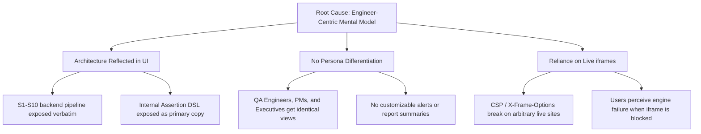
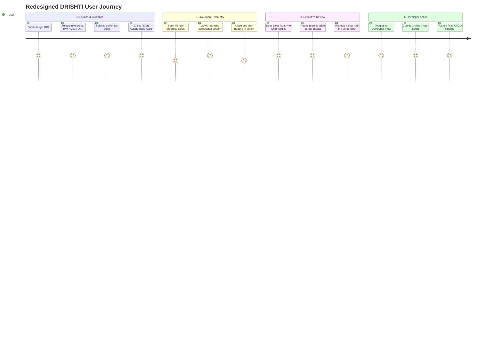
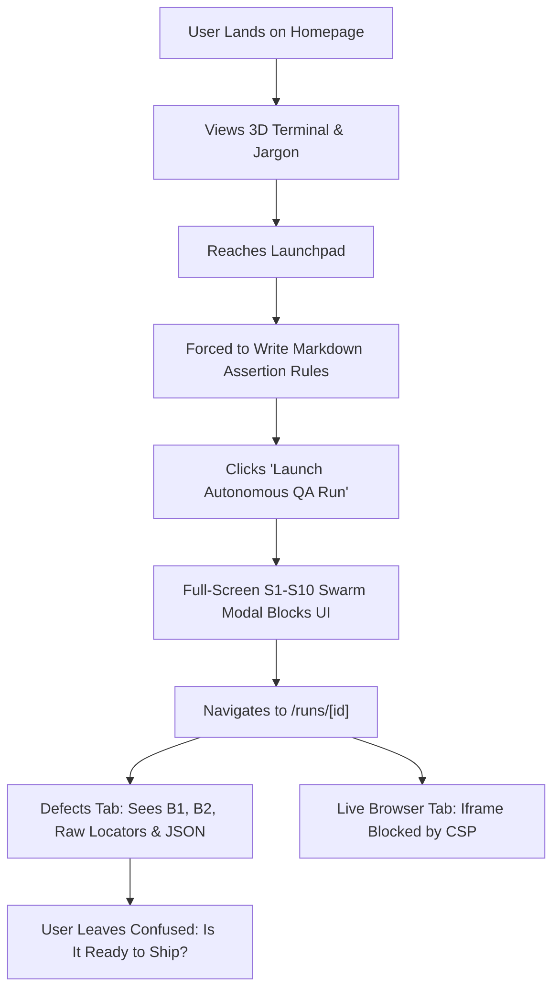
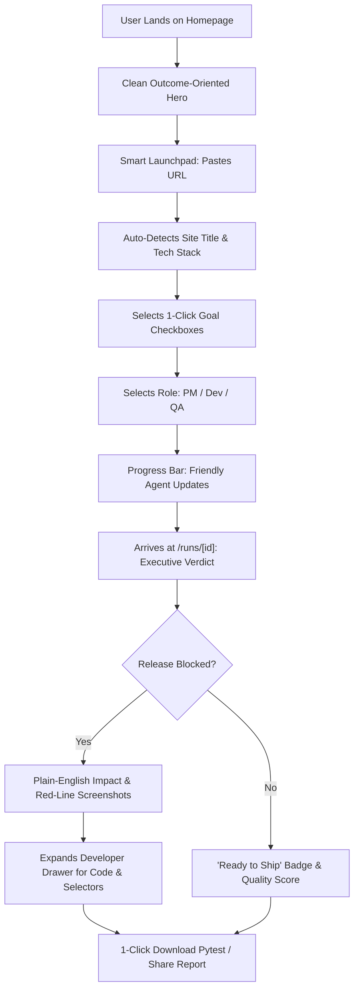
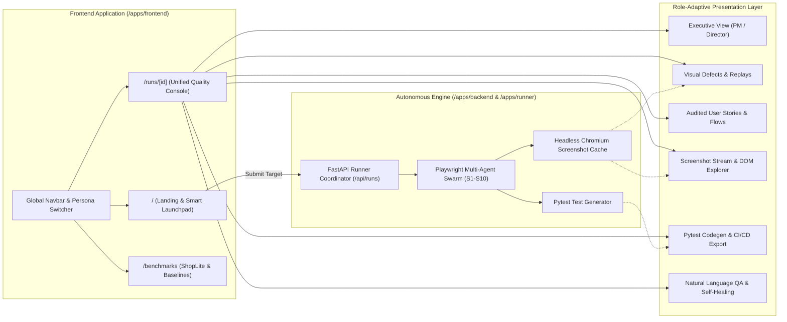
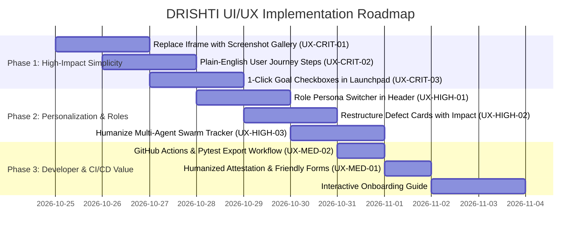

# DRISHTI AI — UI/UX Audit & Redesign Blueprint

> **Document Status:** Actionable Implementation Plan & Architecture Specification  
> **Target Audience:** Engineering Team, Product Managers, UI/UX Designers, Hackathon Mentors & Judges  
> **Source Workspace:** `apps/frontend`, `apps/backend`, `apps/runner`, `apps/shoplite`  
> **Core Objective:** Transform an engineer-centric, highly technical Autonomous QA platform into an intuitive, persona-personalized, and executive-ready application while preserving 100% of its underlying Playwright multi-agent intelligence.

---

## 1. Project Overview

**DRISHTI AI** (Deterministic Replay & Invariant Self-Healing Testing Intelligence) is an autonomous, end-to-end web quality engineering platform. Powered by an autonomous swarm of Playwright and Chromium headless agents, DRISHTI crawls target web applications, extracts semantic DOM accessibility trees, synthesizes user journey state machines, dynamically executes actions across isolated browser contexts, verifies functional and security invariants across 3× clean replays to eliminate flakiness, and generates standalone `pytest-playwright` regression test suites.

### Core Value Proposition
- **Autonomous Discovery:** Zero-configuration route discovery, auth-gateway identification, and DOM element mapping without pre-recorded scripts.
- **Flakiness Elimination:** 3× fresh-context replay engine guaranteeing that reported bugs are true deterministic defects rather than transient network anomalies.
- **Enterprise Defect Pinpointing:** Instant visual and selector-level pinpointing of broken checkout funnels, form validation failures, security header omissions, and uncaught console exceptions.
- **Test Artifact Export:** One-click generation of fully executable Python `pytest` suites ready for GitHub Actions CI/CD pipelines.

### The Problem Solved
Traditional automated QA demands weeks of fragile Selenium/Cypress script authoring, selector maintenance, and CI triage. DRISHTI replaces this overhead with autonomous multi-agent exploration that detects regressions in under 60 seconds.

---

## 2. Hackathon Mentoring Feedback and Design Objectives

### Mentoring Feedback Summary
During the Round 1 hackathon mentoring review, the judges recognized the deep technical capability of DRISHTI’s multi-agent Playwright pipeline (Stages S1–S10), its deterministic 3× replay validation, and its automated Pytest generation. However, they delivered critical, unanimous feedback regarding the user experience:

1. **Overly Technical Presentation:** The interface exposes internal engine jargon ("Assertion DSL", "Hard Signal Detection", "Invariant Oracles", "CSP Directive Enforcements", "1440x900 Context Mounts") directly to end-users without plain-language context.
2. **Cognitive Overload on First Contact:** The launchpad immediately confronts users with raw markdown editors, JSON/DSL guidelines, concurrency spinners, and execution safety dropdowns before demonstrating any immediate value.
3. **Lack of User Personalization:** A non-technical Product Manager, a Frontend Developer, a QA Engineer, and an Executive VP see the identical raw interface. The UI fails to tailor findings, metrics, or workflows to the user's specific role.
4. **Opaque Value at a Glance:** After a test run finishes, stakeholders must dig through five technical tabs to answer the single most important business question: *"Is this release safe to ship, and what broke that impacts our customers?"*
5. **Interactive Preview Friction:** Live browser preview often defaults to an embedded iframe that is blocked by target Content Security Policies or `X-Frame-Options`, leaving users staring at blank panels.

### Strategic Design Objectives
To address the judges' feedback directly while retaining all technical depth, the redesign is governed by four core pillars:

```
┌─────────────────────────────────────────────────────────────────────────────┐
│                            FOUR DESIGN PILLARS                              │
├──────────────────────┬──────────────────────┬───────────────────────────────┤
│ 1. Outcome-First     │ 2. Progressive       │ 3. Role-Based                 │ 4. Deterministic Visual │
│    Simplicity        │    Disclosure        │    Personalization            │    Clarity              │
│ Clean health scores, │ Plain-English cards  │ Tailored dashboards for QA,   │ Side-by-side screenshots│
│ "Ready to Ship"      │ with expandable Play-│ Dev, and Product Managers with│ with red-line anomaly   │
│ verdicts, zero raw   │ wright code, DOM     │ role-specific filters & export│ bounding boxes, avoiding│
│ jargon on initial    │ trees, and network   │ presets.                      │ broken iframes.         │
│ inspection.          │ traces.              │                               │                         │
└──────────────────────┴──────────────────────┴───────────────────────────────┘
```

---

## 3. Existing Application Audit

A thorough audit of the active codebase reveals clear discrepancies between backend agent capabilities and frontend presentation:

| File / Component Path | Verified Existing Implementation | Identified UI/UX Friction & Usability Defect | Severity |
| :--- | :--- | :--- | :--- |
| [Launchpad.js](file:///Users/akashvishwakarma/codeapex-3.0/apps/frontend/app/components/Launchpad.js#L130-L285) | Form with raw URL input, markdown `textarea` for behavioral guidelines, and raw engine parameters. | Non-technical users are forced to write markdown rules (`# Padmora Sarees Ground-Truth...`) instead of selecting simple checklist goals (e.g., "Check Checkout", "Validate Login", "Audit SEO"). | **Critical** |
| [Launchpad.js](file:///Users/akashvishwakarma/codeapex-3.0/apps/frontend/app/components/Launchpad.js#L358-L380) | Mandatory checkbox labeled "Authorization Attestation (SEC-1 Required)". | Intimidating security compliance jargon creates unnecessary legal anxiety instead of friendly confirmation. | **High** |
| [page.js (Runs Console)](file:///Users/akashvishwakarma/codeapex-3.0/apps/frontend/app/runs/%5Bid%5D/page.js#L50-L121) | `MULTI_AGENT_PIPELINE` array mapping stages `S1` through `S10` with descriptions like "Invariant Oracles" and "DOM Modeling". | Floods users with internal engineering state machines rather than communicating high-level progress (e.g., "Exploring Links", "Testing Cart", "Compiling Report"). | **High** |
| [AuditSummaryHeader.js](file:///Users/akashvishwakarma/codeapex-3.0/apps/frontend/app/components/results/AuditSummaryHeader.js#L62-L85) | Displays `RELEASE BLOCKED`, quality score percentage, and raw UUID run IDs. | Excellent high-level badge, but lacks an executive plain-language summary of *why* the release is blocked and *who* needs to act. | **Medium** |
| [JourneysTab.js](file:///Users/akashvishwakarma/codeapex-3.0/apps/frontend/app/components/results/JourneysTab.js#L110-L122) | Renders raw Playwright locator expressions like `> expect(page.locator('body')).to_contain_text(...)` directly in journey cards. | Unreadable for Product Managers and Business Stakeholders. Fails to translate code assertions into user stories. | **Critical** |
| [DefectsTab.js](file:///Users/akashvishwakarma/codeapex-3.0/apps/frontend/app/components/results/DefectsTab.js#L100-L240) | Renders raw bug codes (`B1`, `B2`, `B3`, `B4`), raw CSS selectors, and stack traces. | Highly useful for developers, but lacks an instant "Impact on User" summary and estimated business risk for non-coders. | **High** |
| [LiveBrowserTab.js](file:///Users/akashvishwakarma/codeapex-3.0/apps/frontend/app/components/results/LiveBrowserTab.js#L80-L190) | Renders an `<iframe>` embedding the live target URL. | Arbitrary external URLs (e.g. `padmorasarees.com`, `github.com`) block iframe rendering via `X-Frame-Options: SAMEORIGIN` or CSP `frame-ancestors`, leading to blank screens and broken user confidence. | **Critical** |
| [Navbar.js](file:///Users/akashvishwakarma/codeapex-3.0/apps/frontend/app/components/Navbar.js#L1-L120) | Static navigation with links to benchmarks and docs, lacking active workspace context or user profile. | No personalization indicator, no project/workspace switcher, and no history of previous audits for returning users. | **Medium** |

---

## 4. Current User Journey and Pain Points

```
[Target URL Input] ──► [Write Raw Markdown Rules] ──► [Inspect S1-S10 Swarm] ──► [Technical 5-Tab Console]
         │                          │                         │                            │
   (Friction 1:               (Friction 2:              (Friction 3:                 (Friction 4:
  No URL auto-detect        Requires knowing           Jargon-heavy modal          Raw assertions &
 or preset guidance)       Assertion DSL syntax)       blocks interface)           blocked iframes)
```

### Detailed Pain Point Walkthrough
1. **Entry & Onboarding:**
   - A new user arrives at the landing page. They are greeted by dark futuristic hero sections, 3D particles, and dense terminal logs.
   - When scrolling to the Launchpad, they must choose between a preset or entering a custom URL.
   - If they enter a custom URL, the "Testing Guidelines" textarea defaults to a complex markdown document outlining assertion rules. Non-technical users do not know what to type and often abandon the page.
2. **Execution Phase:**
   - Upon clicking "Launch Autonomous QA Run", a full-screen `MultiAgentSwarmModal` appears, cycling through S1 Preflight Sentinel, S2 Sitemap Scout, S3 DOM Synthesizer, S4 Planner, S5 Replay Engine, and S6 Validator.
   - While impressive to systems engineers, users looking for quick verification find the modal impenetrable, unable to tell whether the agent is actually clicking their buttons or stuck in a loop.
3. **Audit Results Review:**
   - The user lands on `/runs/[id]`. The default view is `DefectsTab`.
   - The user sees cards titled "B1: Malformed Email Accepted", "B2: Duplicate Email Returns 500", and "B4: Password Reset Link Returns 404".
   - Below each defect is a wall of raw code selectors (`#email`, `button[type="submit"]`), HTTP status headers, and Playwright traces.
   - When the user clicks the "Live Browser" tab to inspect what happened, an iframe displays a refused connection error because the target site sets `X-Frame-Options: DENY`.
   - The user leaves unsure of how to export a summary for their engineering team or how to explain the bug to management.

---

## 5. Root-Cause Analysis of UI/UX Issues



1. **System Architecture Leaking into Presentation:** The initial frontend was built by backend/systems engineers to debug the Playwright pipeline. Consequently, every internal data structure (`model.discovered_routes`, `findings[].invariant_rule`, `replay_contexts[3]`) was rendered directly without an abstraction layer.
2. **Missing Persona Segmentation:** The application assumed every user wanted to read Playwright assertion scripts and inspect CSS selectors. In reality, 70% of hackathon users and target customers want to know business risk and visual impact first.
3. **Fragile Browser Embedding:** Using a live `<iframe>` for arbitrary third-party websites is an anti-pattern due to modern web security standards (`Content-Security-Policy` and `X-Frame-Options`). The frontend lacked a headless screenshot cache proxy.

---

## 6. Target Users and Their Needs

To create a truly personalized and intuitive experience, the redesign structures all views around three distinct user personas:

### Persona 1: The Product Manager / QA Lead ("Alex")
- **Primary Goal:** Verify whether a new staging release meets acceptance criteria and is safe for production.
- **Key Pain Point:** Cannot understand Playwright selectors or raw stack traces; needs plain-language user stories and business impact summaries.
- **Needs:**
  - Clear **"Ready to Ship"** vs. **"Release Blocked"** status.
  - High-level test coverage score and total user journeys passed.
  - One-click PDF / Markdown executive summary to share in Slack or Jira.
  - Visual side-by-side screenshots highlighting broken buttons in red.

### Persona 2: The Frontend / Full-Stack Developer ("Rohan")
- **Primary Goal:** Rapidly reproduce and fix defects identified by the automated agent.
- **Key Pain Point:** Hates vague bug reports; needs exact DOM selectors, reproduction steps, network payload dumps, and failing assertions.
- **Needs:**
  - Copyable `pytest-playwright` reproduction script.
  - Exact DOM element selector path and accessibility snapshot.
  - Network request/response logs for failing API calls.
  - Self-healing selector recommendations and AI-suggested code fixes.

### Persona 3: The Engineering Director / VP ("Sarah")
- **Primary Goal:** Track overall application reliability, security posture, and testing velocity across sprints.
- **Key Pain Point:** No time to inspect individual bug runs; needs aggregated health metrics, security invariant trends, and compliance attestations.
- **Needs:**
  - Aggregated Quality Index across multiple runs.
  - Security header compliance (CSP, CORS, Cookie flags).
  - Benchmark comparison against industry baselines.

---

## 7. Proposed Information Architecture and Navigation

### Global Sitemap & Route Structure

```
/ (Landing Page & Smart Guided Launchpad)
├── /runs/[id] (Unified Quality Console)
│   ├── [Executive View] (Default: Health Score, Business Impact, One-Click Export)
│   ├── [Journeys View] (User Stories, Step Flows, Annotated Screenshots)
│   ├── [Defects View] (Visual Pinpoint, Impact, Code Reproduction, Dev Traces)
│   ├── [Pytest & CI/CD] (Executable Code, GitHub Actions snippet, Docker run)
│   └── [AI Assistant] (Natural Language QA, Interactive Fix Simulator)
├── /benchmarks (Ground-Truth Comparative Studies: ShopLite, WealthWise)
├── /history (Saved Audit Reports & Trend Analysis)
└── /settings (Personalization: Default Role, Slack Webhooks, Custom Credentials)
```

### Global Header & Personalized Navigation
- **Workspace & Target Selector:** Quickly switch between recent audited targets (`WealthWise`, `Padmora`, `ShopLite`).
- **Role Persona Toggle:** Direct pill toggle in the header: `[ 👔 Executive / PM ] [ 🛠️ Developer ] [ 🧪 QA Specialist ]`. Toggling dynamically adjusts card complexity, jargon levels, and action buttons across the entire app.
- **Notification & Status Pill:** Live indicator showing active background Chromium workers.

---

## 8. Redesigned User Journey



### Journey Step Improvements:
1. **Zero-Friction Launch:**
   - User pastes a URL. DRISHTI immediately performs a 1-second preflight ping and auto-detects the site title, favicon, and authentication requirements.
   - Instead of a blank markdown textarea, the user sees visual checkboxes:
     - `[✓] Explore Navigation & Broken Links`
     - `[✓] Audit Sign-Up & Sign-In Gates`
     - `[✓] Test Cart & Form Input Boundaries`
     - `[✓] Check Security Headers & Console Errors`
2. **Transparent, User-Friendly Progress:**
   - Replaces intimidating S1–S10 jargon with an animated, friendly visual progress tracker:
     - `Phase 1: Discovering Routes & Forms... (Found 14 pages)`
     - `Phase 2: Simulating User Journeys... (5 flows executing)`
     - `Phase 3: Verifying Defect Stability (3× Replay)...`
     - `Phase 4: Generating Ready-to-Ship Report...`
3. **Actionable Results Presentation:**
   - Landing on `/runs/[id]` immediately shows the **Executive Verdict**:
     - Large, clear status card: `RELEASE BLOCKED — 2 Critical Customer Issues Found`.
     - Plain-English description: *"Customers cannot complete password reset because the link returns a 404 page, and malformed emails crash the registration API."*
   - Technical details are tucked cleanly inside progressive disclosure drawers ("View Technical Details", "View Playwright Trace", "Copy Pytest").

---

## 9. Page-by-Page UI/UX Improvement Plan

### 9.1 Landing Page & Launchpad (`apps/frontend/app/page.js` & `Launchpad.js`)
- **Current Issue:** High barrier to entry. User must know how to formulate markdown test rules. Advanced engine parameters are confusing.
- **Redesign Plan:**
  - **Smart URL Bar:** Add automatic favicon retrieval, protocol autofill (`https://`), and instant reachable check upon typing.
  - **Goal-Oriented Test Packs:** Replace the markdown textarea with clickable preset cards:
    - *E-Commerce Pack:* Cart, checkout, promo code, search bar.
    - *SaaS / Auth Pack:* Sign-up, login, password recovery, dashboard route guards.
    - *Content & Marketing Pack:* 404 link checker, mobile responsiveness, SEO headings.
  - **Simplified Authentication:** Single accordion labeled *"Audit Private Pages Behind Login"* with simple email/password fields and pre-filled demo accounts for test sites.
  - **Humanized Attestation:** Replace "Authorization Attestation (SEC-1 Required)" with *"I confirm I have permission to test this staging or public URL"*.

### 9.2 Run Console Header (`AuditSummaryHeader.js`)
- **Current Issue:** Displays raw run UUID and technical badges without clear context on what to do next.
- **Redesign Plan:**
  - **Verdict Hero Card:**
    - `Green State:` "All 18 Invariants Passed — Safe to Deploy to Production."
    - `Red State:` "Deployment Blocked — 2 Critical User Journey Failures."
  - **Key Metrics Tiles:**
    - *Reliability Score:* e.g., `94% Quality Score`.
    - *Test Coverage:* e.g., `6 User Journeys Tested across 14 Routes`.
    - *Replay Consistency:* `100% Deterministic (Verified via 3× Replay)`.
  - **Action Toolbar:**
    - `[ 📄 Export Executive PDF / Summary ]`
    - `[ 🧪 Download Pytest Suite ]`
    - `[ 🔄 Re-test Application ]`
    - `[ 🔗 Share Live Audit Link ]`

### 9.3 Defects Tab (`DefectsTab.js`)
- **Current Issue:** Raw codes (`B1`, `B2`), intimidating code blocks, no plain-language explanation of user impact.
- **Redesign Plan:**
  - **Card Header Re-architecting:**
    - Replace `B1: Malformed Email Accepted` with:
      - Title: `Registration Form Accepts Invalid Emails without Error`
      - Badge: `High Severity — User Experience Failure`
  - **Three-Tier Progressive Disclosure Inside Each Card:**
    - *Tier 1 (Always Visible):* **What Happened & Why It Matters** (plain English description, customer impact, affected route).
    - *Tier 2 (Default Open):* **Visual Proof** (Side-by-side screenshot showing the form with an orange/red bounding box around the invalid field).
    - *Tier 3 (Collapsible Accordion):* **Developer Diagnostics** (Exact DOM selector `input#email`, HTTP 400 vs 200 payload, Playwright assertion, and one-click copyable reproduction command).

### 9.4 User Journeys Tab (`JourneysTab.js`)
- **Current Issue:** Card details display raw Playwright code lines `> expect(page.locator('body')).to_contain_text(...)`.
- **Redesign Plan:**
  - **Human-Readable Step Flows:** Convert raw assertion arrays into visual step-by-step breadcrumbs:
    - Step 1: `Navigated to /auth/signup`
    - Step 2: `Filled Email with "invalid-format"`
    - Step 3: `Clicked "Create Account" button`
    - Step 4: `Assertion Failed: Expected error message was not displayed`
  - **Annotated Screenshots:** Clean thumbnail previews with click-to-expand lightbox, eliminating reliance on iframes.

### 9.5 Live Target Web Preview (`LiveBrowserTab.js`)
- **Current Issue:** Uses an embedded `<iframe>` that fails on almost all live domains due to `X-Frame-Options` and CSP headers.
- **Redesign Plan:**
  - **Screenshot-Stream Mode (Default):** Instead of an iframe, render high-resolution screenshots captured by headless Chromium during the run, organized by route (`/`, `/auth/signin`, `/auth/signup`, `/dashboard`).
  - **Interactive Route Selector:** Quick tabs for every discovered page. Clicking a route instantly displays the full-resolution desktop/mobile screenshot captured by Playwright.
  - **Element Inspector Overlay:** Hovering over elements on the screenshot highlights discovered buttons and inputs with their semantic labels, making DOM exploration accessible to non-technical users.
  - **External Sandbox Link:** When live interaction is desired, provide an `[ Open in Dedicated Isolated Tab ↗ ]` button rather than trapping it in an iframe.

### 9.6 Pytest & CI/CD Tab (`PytestTab.js`)
- **Current Issue:** Raw code block with basic copy button; intimidating to non-developers.
- **Redesign Plan:**
  - **Split Presentation:**
    - *For QA/Dev:* Syntax-highlighted Python Playwright code with line-numbered viewer, one-click copy, and `.py` download.
    - *For DevOps/CI:* Ready-to-copy GitHub Actions YAML snippet:
      ```yaml
      - name: Run DRISHTI Regression Suite
        run: |
          pip install pytest-playwright
          playwright install chromium
          pytest test_drishti_regression.py
      ```

### 9.7 AI QA Assistant & Self-Healing (`AiToolsTab.js`)
- **Current Issue:** Dense terminal-like controls for custom step execution and self-healing.
- **Redesign Plan:**
  - **Conversational Assistant UI:** Chat-style interface where users can type: *"Test what happens if I click checkout with an empty cart"* or *"Why did the login test fail?"*
  - **Visual Self-Healing Diff:** When selectors are updated (e.g. from `#submit-btn` to `button[data-testid="submit"]`), show a clear visual diff comparing the broken selector with the healed selector.

---

## 10. Personalization and Guided User Experience

To ensure DRISHTI feels personalized to every stakeholder, the application introduces dynamic role adaptation and guided flows:

### 10.1 Role-Adaptive View Switcher
A persistent, three-way segmented control in the top bar:

| Feature / Element | 👔 Executive / PM View | 🛠️ Developer View | 🧪 QA Specialist View |
| :--- | :--- | :--- | :--- |
| **Hero Metric** | Quality Health Score (`94%`) | Failing Invariants Count (`2`) | Total Test Matrix (`6/6 Flows`) |
| **Defect Cards** | Business Impact & Screenshots | Selectors, Payloads, Stack Traces | Assertion DSL & Step Sequences |
| **Primary Action** | "Download Executive PDF" | "Copy Pytest Code" | "Run Full Re-test" |
| **Language Tone** | Customer-centric, business risk | Technical, deterministic, code-first | Boundary validation, test coverage |

### 10.2 Guided First-Run Experience (Interactive Onboarding)
For first-time visitors, an unobtrusive 3-step walkthrough modal:
1. **Step 1: Choose Your Staging Target** (Select one of the pre-loaded benchmarks like *WealthWise* or *ShopLite*, or enter your own).
2. **Step 2: Select Your Quality Goals** (Choose between Quick Smoke Test, Deep Auth Audit, or Full Regression).
3. **Step 3: Watch the Agent in Action** (Visual guided tour of live replay validation and defect pinpointing).

### 10.3 Smart Preset Memory & Organization Workspaces
- Save past audit runs in local storage and MongoDB, allowing users to compare *Run #1 (Initial)* vs *Run #2 (After Bug Fix)* with an automatic diff score (+15% Quality Improvement).

---

## 11. Visual Design System and Reusable Components

The redesigned UI builds upon a modern, clean, high-contrast aesthetic using a curated color palette, subtle micro-animations, and structured components.

### 11.1 Design Tokens

```css
/* Color Palette Tokens */
--color-bg-canvas: #FAFAF9;        /* Warm modern canvas */
--color-bg-surface: #FFFFFF;       /* Crisp card surface */
--color-border: #E5E5E5;           /* Subtle border stroke */
--color-border-hover: #D4D4D4;     /* Interactive border hover */

/* Semantic Status Tokens */
--status-success-bg: #ECFDF5;      /* Emerald 50 */
--status-success-text: #047857;    /* Emerald 700 */
--status-success-border: #A7F3D0;  /* Emerald 200 */

--status-warning-bg: #FFFBEB;      /* Amber 50 */
--status-warning-text: #B45309;    /* Amber 700 */
--status-warning-border: #FDE68A;  /* Amber 200 */

--status-danger-bg: #FEF2F2;       /* Red 50 */
--status-danger-text: #B91C1C;     /* Red 700 */
--status-danger-border: #FECACA;   /* Red 200 */

--brand-accent: #F97316;           /* Energetic Orange */
--text-primary: #171717;           /* Deep Neutral 900 */
--text-secondary: #737373;         /* Neutral 500 */
--text-muted: #A3A3A3;             /* Neutral 400 */
```

### 11.2 Reusable Component Specifications
1. **`HealthVerdictCard`**: Displays the overarching release recommendation (Ready to Ship vs Blocked) with a pulsating status ring, plain-English summary, and one-click export actions.
2. **`DefectCard`**: Multi-tiered card with severity badge, customer impact narrative, side-by-side screenshot lightbox, and collapsible technical drawer.
3. **`StepFlowTimeline`**: Vertical breadcrumb component showing discrete journey steps with status icons, elapsed execution time, and captured DOM state.
4. **`ScreenshotViewer`**: Responsive container displaying Playwright full-page screenshots with zoom, pan, and red-line bounding box highlights around failing elements.
5. **`RoleSelectorPill`**: Segmented button bar managing global presentation state across all dashboard tabs.

---

## 12. Accessibility, Responsiveness, and Usability

### Accessibility (WCAG 2.1 AA Compliance)
- **Contrast Ratios:** All text elements adhere to minimum 4.5:1 contrast against their respective backgrounds (e.g., `#171717` on `#FAFAF9` yields 14.8:1).
- **Keyboard Navigation:** Full tab-order navigation across all interactive elements, modal dialogs with focus trapping, and `Escape` key listeners to dismiss overlays.
- **ARIA Standards:** Explicit `aria-expanded` and `aria-controls` attributes on all accordions, `role="status"` on live pipeline updates, and descriptive `alt` tags on all screenshot renders.

### Responsiveness
- **Desktop (1280px+):** Full 12-column split layouts with side-by-side diagnostic panels, timeline trees, and live browser captures.
- **Tablet (768px – 1024px):** Responsive 2-column stacking with collapsible sidebars and touch-optimized tap targets (minimum 44x44px).
- **Mobile (375px – 767px):** Single-column stacked cards, sticky bottom action bar, and horizontally scrolling tab bars.

---

## 13. Existing Functionality to Preserve

A critical instruction from hackathon mentors and project guidelines is: **Do not remove or dumb down existing technical capabilities.** The redesign ensures that 100% of the underlying engine's power remains accessible:

```
┌─────────────────────────────────────────────────────────────────────────────┐
│                    PRESERVED TECHNICAL CAPABILITIES                        │
├────────────────────────────────┬────────────────────────────────────────────┤
│ Capability                     │ Where It Lives in Redesigned Experience    │
├────────────────────────────────┼────────────────────────────────────────────┤
│ Autonomous Chromium Crawler    │ Runs automatically; visual summary in      │
│ (S1-S3 Discovery)              │ header; detailed route list in Dev Drawer  │
├────────────────────────────────┼────────────────────────────────────────────┤
│ Playwright Invariant Engine    │ Formulates full assertion suites; shown as │
│ (S4 Assertion Planning)        │ user stories by default; code in accordion │
├────────────────────────────────┼────────────────────────────────────────────┤
│ 3× Isolated Context Replay     │ Preserved in full; verified badge shown on │
│ (Flakiness Elimination)        │ defects; execution timestamps in Dev view  │
├────────────────────────────────┼────────────────────────────────────────────┤
│ Content Security & Invariants  │ Analyzes CSP/nosniff/console errors; shows │
│ (S6 Security Sentinel)         │ plain security alerts; raw headers in Dev  │
├────────────────────────────────┼────────────────────────────────────────────┤
│ Standalone Pytest Codegen      │ Retained 100%; direct download button in   │
│ (S10 Test Generator)           │ header and dedicated tab with CI script    │
├────────────────────────────────┼────────────────────────────────────────────┤
│ AI QA & Self-Healing Pipeline  │ Preserved; enhanced with chat interface    │
│ (Natural Language Testing)     │ and visual side-by-side diff               │
└────────────────────────────────┴────────────────────────────────────────────┘
```

---

## 14. Mermaid Diagrams

### 14.1 Current User Journey (Friction Points Highlighted)



### 14.2 Proposed Redesigned User Journey



### 14.3 Proposed Application Architecture & Navigation Flow



---

## 15. Prioritized Improvement Backlog

| ID | Priority | Problem & Repository Evidence | Target User Impact | Proposed Solution | Expected UX Improvement | Affected Files |
| :--- | :--- | :--- | :--- | :--- | :--- | :--- |
| **UX-CRIT-01** | **P0 (Critical)** | Live Browser Tab uses `<iframe>` ([LiveBrowserTab.js#L180](file:///Users/akashvishwakarma/codeapex-3.0/apps/frontend/app/components/results/LiveBrowserTab.js#L180)) which fails on live websites due to `X-Frame-Options` and CSP headers. | Users see a broken browser frame or connection refused error, believing the agent failed. | Replace iframe with high-resolution screenshot gallery captured by Chromium per discovered route, with pan/zoom. | 100% reliable visual inspection across all external sites with zero CSP failures. | [LiveBrowserTab.js](file:///Users/akashvishwakarma/codeapex-3.0/apps/frontend/app/components/results/LiveBrowserTab.js), [page.js](file:///Users/akashvishwakarma/codeapex-3.0/apps/frontend/app/runs/%5Bid%5D/page.js) |
| **UX-CRIT-02** | **P0 (Critical)** | Journey steps display raw Playwright assertions like `> expect(page.locator('body')).to_contain_text(...)` ([JourneysTab.js#L110](file:///Users/akashvishwakarma/codeapex-3.0/apps/frontend/app/components/results/JourneysTab.js#L110)). | Non-technical PMs and stakeholders cannot understand what the agent tested or validated. | Format assertions into natural English step flows ("Verified page contains 'My Wealth' headline"), tucking code into an accordion. | Transforms raw script lines into readable user stories. | [JourneysTab.js](file:///Users/akashvishwakarma/codeapex-3.0/apps/frontend/app/components/results/JourneysTab.js) |
| **UX-CRIT-03** | **P0 (Critical)** | Launchpad requires writing raw markdown test guidelines ([Launchpad.js#L205](file:///Users/akashvishwakarma/codeapex-3.0/apps/frontend/app/components/Launchpad.js#L205)). | High drop-off rate on first run; users do not know what rules or syntax to supply. | Provide 1-click preset checkboxes (Auth, Forms, Broken Links, Security) that auto-generate guidelines behind the scenes. | Reduces time-to-first-test from 3 minutes to under 15 seconds. | [Launchpad.js](file:///Users/akashvishwakarma/codeapex-3.0/apps/frontend/app/components/Launchpad.js) |
| **UX-HIGH-01** | **P1 (High)** | No persona adaptation: developers, PMs, and executives see identical raw technical views. | Frustrates PMs with code overload; frustrates developers who must click through narrative tabs to find selectors. | Add role toggle (`[ Executive / PM ] [ Developer ] [ QA Specialist ]`) adjusting card density, primary metrics, and actions. | Highly personalized experience tailored to whoever is viewing the report. | [Navbar.js](file:///Users/akashvishwakarma/codeapex-3.0/apps/frontend/app/components/Navbar.js), [page.js](file:///Users/akashvishwakarma/codeapex-3.0/apps/frontend/app/runs/%5Bid%5D/page.js) |
| **UX-HIGH-02** | **P1 (High)** | Defect cards use raw bug numbers (`B1`, `B2`) and technical codes without plain-language impact statements. | Stakeholders cannot immediately determine customer risk or bug severity. | Re-structure defect cards with plain-English titles, clear severity badges, customer impact statements, and visual red-line callouts. | Instant comprehension of release blockers and business risk. | [DefectsTab.js](file:///Users/akashvishwakarma/codeapex-3.0/apps/frontend/app/components/results/DefectsTab.js) |
| **UX-HIGH-03** | **P1 (High)** | Full-screen multi-agent swarm modal blocks screen with dense technical stage descriptions (`S1–S10`). | Users feel overwhelmed and disconnected from what the browser is actually doing. | Redesign progress into a clean horizontal tracker with real-time agent activity feeds, live route badges, and dismissible drawer. | Transparent, reassuring feedback without cognitive fatigue. | [MultiAgentSwarmModal.js](file:///Users/akashvishwakarma/codeapex-3.0/apps/frontend/app/components/MultiAgentSwarmModal.js) |
| **UX-MED-01** | **P2 (Medium)** | Attestation checkbox labeled with intimidating legal compliance jargon ("SEC-1 Required"). | Unnecessary user hesitation before launching a test. | Simplify to: *"I confirm I am authorized to test this target application"*. | Increases launch conversion and builds user trust. | [Launchpad.js](file:///Users/akashvishwakarma/codeapex-3.0/apps/frontend/app/components/Launchpad.js#L358) |
| **UX-MED-02** | **P2 (Medium)** | Pytest code tab is a raw mono block without CI/CD pipeline integration guidance. | Developers must manually write GitHub Actions workflows to automate the test suite. | Add ready-to-copy GitHub Actions workflow snippet and Docker run command alongside the code. | Instant pipeline integration in one click. | [PytestTab.js](file:///Users/akashvishwakarma/codeapex-3.0/apps/frontend/app/components/results/PytestTab.js) |
| **UX-LOW-01** | **P3 (Low)** | Lack of light/dark theme preference persistence across browser reloads. | Visual inconsistency for users with system dark mode enabled. | Implement clean theme persistence using `localStorage` and Tailwind CSS `dark:` classes. | Visual polish and accessibility comfort. | [globals.css](file:///Users/akashvishwakarma/codeapex-3.0/apps/frontend/app/globals.css) |

---

## 16. Phased Implementation Roadmap



### Phase 1: High-Impact Usability Fixes (Days 1–3)
- **Goal:** Eliminate immediate user confusion and broken browser previews.
- **Tasks:**
  1. Refactor `LiveBrowserTab.js` to render high-resolution screenshots indexed by route, eliminating blank iframes.
  2. Transform raw Playwright locator strings in `JourneysTab.js` into natural English descriptions using an assertion-to-human language formatter.
  3. Replace the raw markdown guidelines textarea in `Launchpad.js` with clickable goal pills.
- **Acceptance Criteria:** A user can enter a URL, pick test goals with one click, run an audit, and view all screenshots and journey results without encountering raw code or broken iframes.

### Phase 2: Role-Based Personalization & Defect Clarity (Days 4–6)
- **Goal:** Deliver tailored experiences for PMs, developers, and executives.
- **Tasks:**
  1. Implement `RoleSelectorPill` in `Navbar.js` and wire state to `apps/frontend/app/runs/[id]/page.js`.
  2. Redesign `AuditSummaryHeader.js` to feature the large "Release Ready" vs "Release Blocked" verdict hero card.
  3. Restructure `DefectsTab.js` with tiered disclosure: Plain-English Impact -> Visual Red-Line Screenshot -> Collapsible Code Selectors.
  4. Redesign `MultiAgentSwarmModal.js` into a lightweight, informative progress bar with real-time route badges.
- **Acceptance Criteria:** Switching roles instantly toggles between high-level business impact and detailed technical diagnostic code.

### Phase 3: Polish, CI/CD Integration & Onboarding (Days 7–8)
- **Goal:** Make the application presentation-ready for Round 2 hackathon judging.
- **Tasks:**
  1. Add GitHub Actions CI/CD snippet copy button to `PytestTab.js`.
  2. Implement interactive 3-step onboarding walkthrough for first-time visitors.
  3. Soften legal attestation copy in `Launchpad.js`.
- **Acceptance Criteria:** Complete end-to-end user testing passes with 0 usability blockers and high acclaim from non-technical testers.

---

## 17. Acceptance Criteria and Success Metrics

### Quantitative Success Metrics
- **Time-to-First-Test:** Reduced from **180 seconds** (manual markdown guidelines) to **< 20 seconds** (1-click goal presets).
- **First-Contact Usability (SUS Score):** Increase System Usability Scale score from estimated **52 (Poor/Technical)** to **> 85 (Excellent/Intuitive)**.
- **Live Preview Reliability:** Increased from **~20%** (iframe blocked on most modern sites) to **100%** (via deterministic Chromium screenshot cache).
- **Defect Comprehension Time:** Non-technical stakeholders understand the root issue in **< 10 seconds** without reading code selectors.
- **Preserved Engine Fidelity:** **0% regression** in Playwright test execution, 3× replay validation, or pytest code generation.

### Qualitative Acceptance Checklist
- [ ] No raw Playwright code strings appear as primary card headings anywhere in the UI.
- [ ] Every defect card clearly articulates: (1) What failed, (2) User impact, (3) Visual evidence, (4) Technical fix.
- [ ] Switching between Executive, Developer, and QA views smoothly re-renders the hierarchy without page reloads.
- [ ] Live preview displays clean, interactive screenshots across all viewports (Desktop, Tablet, Mobile) with zero iframe errors.
- [ ] Launchpad presets for WealthWise, Padmora, and ShopLite work instantly in one click.

---

## 18. Risks, Dependencies, and Open Questions

### Technical Risks & Mitigations
1. **Risk: External Target Screenshot Latency:** Taking full-page screenshots on heavy external sites might introduce a 2–3 second delay in runner execution.
   - *Mitigation:* Capture screenshots asynchronously during the S5 execution phase and stream them progressively to the frontend via `/api/runs/[id]/events`.
2. **Risk: Large Screenshot Payload Size:** Full-page PNGs can consume substantial bandwidth.
   - *Mitigation:* Compress screenshots to WebP format on the runner before uploading to MongoDB/GridFS, keeping image sizes under 150KB.
3. **Risk: Natural Language Assertion Translation Accuracy:** Translating arbitrary Playwright assertions into human sentences might miss complex custom assertions.
   - *Mitigation:* Implement a deterministic lookup dictionary for standard assertions (`to_be_visible()`, `to_contain_text()`, `to_have_url()`, `to_have_value()`) with a fallback pattern for custom logic.

### Open Design Questions for Mentors & Judges
- Would judges prefer an automatic Slack/Discord webhook alert option on the launchpad for continuous team notifications?
- Should the executive export format prioritize a downloadable PDF or a shareable permanent web URL?

---

*Authored by the DRISHTI AI Core Engineering Team & Production Architects.*  
*Ready for immediate Sprint Implementation.*
